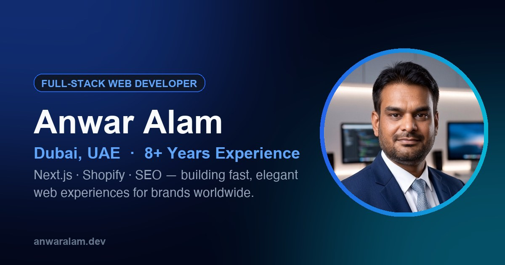

# Anwar Alam — Portfolio

Live at **[iamanwaralam.github.io](https://iamanwaralam.github.io)**



Personal portfolio for Anwar Alam, a full-stack developer based in Dubai, UAE. A fast, animated single-page site with a dedicated case study for each real, shipped project, from client websites and Shopify stores to apps.

## Featured projects

- **[Netcurb](https://iamanwaralam.github.io/projects/netcurb)**: a per-app internet firewall for Android, Linux, Windows and macOS, built from one Kotlin Multiplatform codebase. The Linux version is released.
- **[AKIUAE](https://iamanwaralam.github.io/projects/akiuae)**: a corporate site rebuilt on Next.js 14, plus a zero-downtime hosting migration.
- **[Esthica](https://iamanwaralam.github.io/projects/esthica)**: a Shopify store for a UAE beauty brand.
- **[Beatryx](https://iamanwaralam.github.io/projects/beatryx)**: a Next.js headless storefront that uses Shopify checkout.

All projects are listed in the [Projects section](https://iamanwaralam.github.io/#projects).

## Tech stack

- **React 19** + **TypeScript**, bundled with **Vite**
- **Tailwind CSS v4** for styling
- **Framer Motion** + **GSAP** for animation
- **React Router** for routing, including a page for each case study
- **react-markdown** for blog posts
- React 19's built-in document metadata for per-page SEO, plus JSON-LD structured data, a sitemap and `llms.txt`
- Deployed to GitHub Pages by GitHub Actions on every push to `main`

## Getting started

Requires Node.js 22 (the version the deploy uses).

```bash
npm install
npm run dev          # start the dev server
npm run build        # type-check and build for production
npm run preview      # preview the production build locally
npm run lint         # run ESLint
npm run type-check   # run TypeScript with no emit
```

## Project structure

```
src/
├── components/   # shared UI, layout, command palette
├── sections/     # homepage sections (hero, projects, experience, contact, …)
├── pages/        # routed pages (home, case studies, blog)
├── data/         # site content: projects, case studies, experience, skills, …
├── content/blog/ # blog posts in Markdown
├── context/      # theme and sound providers
├── animations/   # shared Framer Motion variants
└── styles/       # global CSS and Tailwind setup
public/
├── projects/     # project screenshots (1200×750 JPG)
├── resume/       # CV PDF
└── sitemap.xml, llms.txt, robots.txt
docs/             # brand guidelines, design system, requirements, TODO
```

## Editing content

All content lives in `src/data/` as plain TypeScript objects, so there's no CMS. Every claim in a case study is based on what actually shipped, with no invented metrics.

**Adding a project:**

1. Add a screenshot to `public/projects/<slug>.jpg` (1200×750).
2. Add the project to `src/data/projects.ts`. Set `featured: true` to show the Featured badge. If `liveUrl` points to a downloads page, set `download: true` so its buttons say "Download" instead of "Live demo".
3. Add a case study with the same `slug` to `src/data/caseStudies.ts`. In `overview`, a blank line (`\n\n`) starts a new paragraph and `**text**` is bold.
4. Add the case study URL to `public/sitemap.xml` and `public/llms.txt`.

**Adding a blog post:** copy `src/content/blog/_example-post.md` and follow the instructions inside it.

## Old site

The original static HTML portfolio (2019–2026) is kept in the `old-site-archive` tag:

```bash
git checkout old-site-archive
```

## Contact

- [LinkedIn](https://www.linkedin.com/in/iamanwaralam/)
- [GitHub](https://github.com/iamanwaralam)
- [X / Twitter](https://x.com/iamanwaralam)
